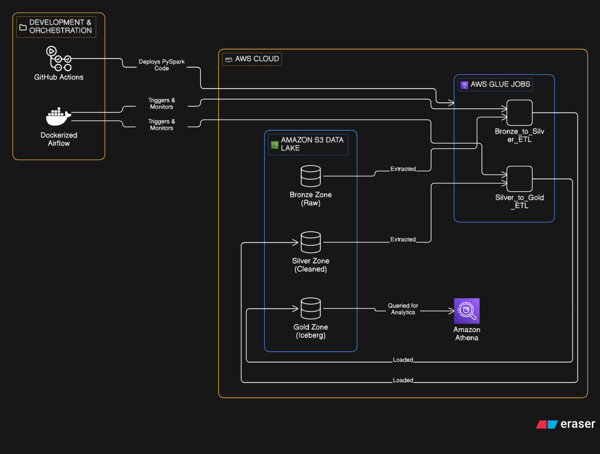

# SwiftRoute Logistics: Cloud Lakehouse & Automated Data Pipeline

[](https://github.com/SharanyaV25-dev/swift-route-logistics-data-engineering/actions)


An enterprise-grade cloud data engineering pipeline simulating a high-throughput logistics and fleet management platform (**350,000+ records across 8 operational tables**). The lakehouse implements a **Medallion Architecture** using **AWS Glue (PySpark)** and **Apache Iceberg**, orchestrated via **Dockerized Apache Airflow**, protected by **6 automated defensive engineering & financial reconciliation tests**, and continuously deployed through **GitHub Actions**.

---

## Business Problem & Key Analytical Questions Answered

In logistics and supply chain networks, shipment and tracking telemetry arrives fragmented across multiple disparate sources with frequent network retries, out-of-order delivery scans, late status corrections, and schema inconsistencies. 

SwiftRoute ingests, validates, and models raw logistics feeds into ACID-compliant **Apache Iceberg Gold Marts** queried via **Amazon Athena** to answer critical operational KPIs:
1. **Revenue & Financial Integrity:** What is the exact recognized freight revenue per customer and load after accounting for late order cancellations and multi-leg transit fan-outs?
2. **Carrier & Route SLA Performance:** Which origin-to-destination routes fall below on-time delivery SLAs or exhibit degraded fuel efficiency (MPG)?
3. **Facility Detention Bottlenecks:** Which warehouse facilities generate the highest truck detention times (in minutes), including late-arriving facility scan telemetry?

---

## Architecture Overview



```text
                      ┌────────────────────────┐
                      │  Raw Logistics Data    │
                      │  (Batch CSV Streams)   │
                      └───────────┬────────────┘
                                  │
                                  ▼
┌────────────────────────────────────────────────────────────────────────┐
│ BRONZE ZONE (Amazon S3)                                                │
│ • Immutable, raw source landed as ingested                             │
│ • Isolated ingestion paths per operational domain entity               │
│ • Empty-batch vs. schema-corruption detection at ingestion boundary    │
└───────────────────────────────┬────────────────────────────────────────┘
                                  │
                                  ▼  [AWS Glue: PySpark Data Quality Engine]
┌────────────────────────────────────────────────────────────────────────┐
│ SILVER ZONE (Amazon S3 / Apache Iceberg)                               │
│ • Recency window deduplication (ROW_NUMBER() OVER updated_at DESC)     │
│ • Cancelled-load revenue restatement policy ($0.00 recognized revenue) │
│ • Strict foreign key referential integrity checks (left anti-joins)    │
│ • Corrupted & orphan records partitioned into S3 Quarantine prefixes   │
└───────────────────────────────┬────────────────────────────────────────┘
                                  │
                                  ▼  [Airflow Quality Gate & Glue Gold ETL]
┌────────────────────────────────────────────────────────────────────────┐
│ GOLD ZONE (Amazon S3 / Apache Iceberg v2 Tables)                       │
│ • Child-table pre-aggregation by load_id preventing 1:N join fan-out   │
│ • Idempotent ACID MERGE INTO upserts protecting against duplicate runs │
│ • Post-publish control total & primary-key grain reconciliation checks │
└───────────────────────────────┬────────────────────────────────────────┘
                                  │
                                  ▼
┌────────────────────────────────────────────────────────────────────────┐
│ SERVING & ANALYTICS                                                    │
│ • Amazon Athena serverless SQL via AWS Glue Data Catalog               │
│ • Operational BI KPIs, carrier SLAs, and facility detention analytics  │
└────────────────────────────────────────────────────────────────────────┘
```

---

## Engineering Reliability: 6 Production Failure Proofs

Rather than assuming happy-path execution, this pipeline is verified against **six real-world production failure modes**, with reproducible test scripts in `validation/` and execution evidence preserved in `run_logs/`:

| # | Failure Scenario | How We Break It | Engineering Defense & Pass Condition | Evidence Log |
| :- | :--- | :--- | :--- | :--- |
| **1** | **Duplicate Delivery** | Deliver the exact same 100-load batch file twice (simulating upstream network retry). | Gold Iceberg `MERGE INTO` upsert & primary-key grain deduplication preserve exact row count (`100`) and revenue (`$50,250.00`). | [`run_logs/test_duplicate_delivery.log`](run_logs/test_duplicate_delivery.log) |
| **2** | **Child-Table Fan-Out** | Join 50 parent `loads` (`$50,000` revenue) with 250 child `delivery_events` (5 events/load). | Naive join inflates revenue 5.0x (`$250,000`). Pre-aggregating `delivery_events` by `load_id` before joining preserves `50` rows and `$50,000.00` revenue. | [`run_logs/test_child_table_fanout.log`](run_logs/test_child_table_fanout.log) |
| **3** | **Order / Load Correction** | Update a prior `COMPLETED` load (`LD00003`, `$1,800`) to `CANCELLED` in a subsequent batch. | Silver recency window (`ROW_NUMBER() OVER (PARTITION BY load_id ORDER BY updated_at DESC)`) selects latest state and restates cancelled revenue to `$0.00`. | [`run_logs/test_late_corrections_and_restatement.log`](run_logs/test_late_corrections_and_restatement.log) |
| **4** | **Late-Arriving Event** | Deliver a facility scan (`EVT003`, 90m detention) 7 days after its business `event_date`. | Pipeline partitions by **event time** (`event_date`) rather than processing time, accurately restating `2026-10-01` SLA rate (`66.67%`) and avg detention (`40.0m`). | [`run_logs/test_late_corrections_and_restatement.log`](run_logs/test_late_corrections_and_restatement.log) |
| **5** | **Task Failure & Retry** | Deliberately fail the Silver validation gate in the Airflow DAG, then fix and retry twice. | `TriggerRule.ALL_SUCCESS` blocks `gold_etl` on failure (`UPSTREAM_FAILED`). Subsequent retries complete with zero duplicate rows or double-counted revenue. | [`run_logs/test_failure_recovery_and_empty_input.log`](run_logs/test_failure_recovery_and_empty_input.log) |
| **6** | **Empty Input Batch** | Deliver a valid header-only (0-row) CSV vs. a malformed CSV missing required columns. | Distinguishes valid holiday empty batches (`EMPTY_VALID_BATCH` warning) from `SCHEMA_CORRUPTION` errors without overwriting downstream marts. | [`run_logs/test_failure_recovery_and_empty_input.log`](run_logs/test_failure_recovery_and_empty_input.log) |

### Production Incident Recovery Note (Sample Post-Mortem)
* **Incident:** Upstream carrier feed re-transmitted `loads` batch `2026-10-15` while simultaneously delivering 5-day-late detention events.
* **Observable Impact:** Unprotected joins between `loads` and `delivery_events` multiplied load revenue 5.0x in exploratory queries.
* **Root Cause:** 1-to-Many cardinality between `loads` (`load_id` grain) and `delivery_events` (`event_id` grain) combined with append-only ingestion.
* **Fix & Prevention:** Enforced `events_by_load` pre-aggregation at the `load_id` grain prior to joining, implemented Iceberg `MERGE INTO` upserts on primary keys, and added an automated post-transform reconciliation check asserting:
  `SUM(silver.loads.revenue) == SUM(gold_load_performance.revenue) == SUM(gold_customer_performance.total_revenue)`

---

## Table Grain & Data Quality Specification

| Table | Layer | Exact Grain (One Row Represents) | Primary Key | Defensive Quality & Quarantine Rules |
| :--- | :--- | :--- | :--- | :--- |
| `loads` | Silver | One unique freight shipment | `load_id` | Quarantines null/negative `weight_lbs`/`revenue`, missing FKs (`customer_id`, `route_id`); zeroes `CANCELLED` load revenue |
| `trips` | Silver | One physical truck dispatch leg | `trip_id` | Quarantines `idle_time_hours > actual_duration_hours` and orphan `load_id`/`driver_id`/`truck_id` via left anti-join |
| `delivery_events` | Silver | One facility scan / milestone | `event_id` | Quarantines `actual_datetime < scheduled_datetime` and orphan `load_id`/`trip_id`/`facility_id` |
| `gold_load_performance` | Gold | One shipment with pre-aggregated SLA metrics | `load_id` | Enforces 1:1 `load_id` uniqueness and 100% revenue control-total parity with Silver `loads` |
| `gold_customer_performance` | Gold | One customer account summary | `customer_id` | Reconciled against Silver `loads` total revenue (`abs(diff) < $0.01`) |
| `gold_daily_operations` | Gold | One calendar business date (`event_date`) | `event_date` | Restated by event time when late telemetry arrives |

---

## Key Architectural Decisions & Trade-Offs

* **Why Apache Iceberg v2 over Standard Hive-Style Parquet?** Logistics shipment statuses frequently mutate (`IN_TRANSIT` → `COMPLETED` or `CANCELLED`) and late facility scans arrive days after initial ingestion. Standard S3 Parquet requires expensive full-partition overwrites to update existing records. Apache Iceberg v2 provides row-level ACID `MERGE INTO` upserts, snapshot isolation, schema evolution, and time-travel auditability without partition write amplification.
* **Why Scheduled Micro-Batch PySpark over Real-Time Streaming (Kafka/Flink)?** At a daily volume of ~350K records across operational tables, scheduled AWS Glue PySpark batch jobs orchestrated by Airflow satisfy operational SLA reporting windows at a fraction of the infrastructure cost and operational overhead of a 24/7 streaming cluster.
* **Quarantine Pattern vs. Hard Fail on Row Corruption:** Rather than failing an entire batch when 1% of carrier records contain negative weights or orphaned foreign keys, the Silver quality engine routes malformed rows to partitioned S3 Quarantine prefixes (`s3://.../quarantine/`) for audit inspection while allowing valid records to proceed to Gold marts with 100% control-total reconciliation.

---

## Tech Stack

| Domain | Technology | Implementation Details |
| :--- | :--- | :--- |
| **Compute & Processing** | PySpark, AWS Glue (Serverless) | Distributed data transformations, recency window deduplication, and pre-aggregations |
| **Storage & Lakehouse** | Amazon S3, Apache Iceberg v2 | Object storage with ACID `MERGE INTO` upserts, time travel, and schema evolution |
| **Catalog & Serving** | AWS Glue Data Catalog, Amazon Athena | Centralized metadata schema repository and serverless Presto/Trino SQL engine |
| **Orchestration** | Apache Airflow 2.10, Docker | DAG with bounded exponential-backoff retries, validation gates, and reconciliation tasks |
| **DevOps & CI/CD** | GitHub Actions, Git | Automated Pytest gating blocking S3 script/DAG deployment on test failure |
| **Testing & Proofs** | Pytest, Validation Suite | Unit tests (`tests/`) plus 6 end-to-end engineering failure simulations (`validation/`) |

---

## Repository Structure

```text
swift-route-logistics-data-engineering/
├── .github/
│   └── workflows/
│       └── ci_cd_pipeline.yml                            # Gated CI/CD workflow (Pytest -> AWS S3 sync)
├── assets/
│   └── pipeline_architecture.png                         # System architecture diagram
├── dags/
│   └── swiftroute_pipeline.py                            # Airflow DAG (Silver -> Validate -> Gold -> Reconcile)
├── docs/
│   ├── messiness_audit.csv                               # Audit log of injected synthetic defects
│   └── silver_quality_report.csv                         # Row-count & timestamp audit report
├── run_logs/
│   ├── test_duplicate_delivery.log                       # Proof Log 1: Duplicate delivery & idempotency
│   ├── test_child_table_fanout.log                       # Proof Log 2: Child-table fan-out prevention
│   ├── test_late_corrections_and_restatement.log         # Proof Log 3 & 4: Status corrections & late events
│   └── test_failure_recovery_and_empty_input.log         # Proof Log 5 & 6: DAG failure recovery & empty input
├── src/
│   ├── rules.py                                          # Centralized PySpark transformation & quality rules
│   ├── bronze_ingestion.py                               # Raw CSV to Bronze layer ingestion
│   ├── silver_transformation.py                          # Local Silver PySpark pipeline (recency window)
│   ├── gold_transformation.py                            # Local Gold PySpark pipeline (fan-out safe + reconciliation)
│   └── glue_jobs/
│       ├── silver_etl.py                                 # Production AWS Glue job for Silver Iceberg layer
│       └── gold_etl.py                                   # Production AWS Glue job for Gold Iceberg layer (MERGE INTO)
├── tests/
│   ├── conftest.py                                       # Session-scoped local PySpark test fixture
│   └── test_silver_rules.py                              # Unit tests for data cleaning & quarantine logic
├── validation/
│   ├── gold_validation.py                                # Gold schema and row-count validation
│   ├── test_duplicate_delivery.py                        # Test 1: Duplicate batch idempotency
│   ├── test_child_table_fanout.py                        # Test 2: Child-table fan-out prevention
│   ├── test_late_corrections_and_restatement.py          # Test 3 & 4: Cancelled loads & 7-day late events
│   └── test_failure_recovery_and_empty_input.py          # Test 5 & 6: DAG retry safety & empty file guard
├── docker-compose.yaml                                   # Local Airflow deployment configuration
├── requirements.txt                                      # Python dependencies
└── README.md
```

---

## Analytical Serving Layer (Sample Amazon Athena Queries)

### 1. Route SLA & Fuel Efficiency Analysis

```sql
SELECT 
    route_id,
    origin_city,
    destination_city,
    total_trips,
    ROUND(avg_trip_duration_hours, 2) AS avg_duration_hrs,
    fuel_efficiency_miles_per_gallon
FROM 
    "swiftroute_iceberg"."gold_route_performance"
WHERE 
    total_trips >= 25
ORDER BY 
    fuel_efficiency_miles_per_gallon ASC;
```

### 2. Facility Congestion & Detention Bottlenecks

```sql
SELECT 
    facility_id,
    facility_name,
    city,
    state,
    total_events,
    on_time_rate,
    ROUND(avg_detention_minutes, 2) AS avg_detention_minutes
FROM 
    "swiftroute_iceberg"."gold_facility_performance"
ORDER BY 
    avg_detention_minutes DESC
LIMIT 10;
```

---

## Local Setup & Reproducing All Engineering Proofs

### 1. Clone & Configure Environment

```bash
git clone [https://github.com/SharanyaV25-dev/swift-route-logistics-data-engineering.git](https://github.com/SharanyaV25-dev/swift-route-logistics-data-engineering.git)
cd swift-route-logistics-data-engineering

python -m venv venv
# Windows PowerShell:
.\venv\Scripts\activate
# Linux/macOS:
source venv/bin/activate

pip install -r requirements.txt
```

### 2. Run Medallion Pipeline & Control-Total Reconciliation

```bash
python src/bronze_ingestion.py
python src/silver_transformation.py
python src/gold_transformation.py
```

### 3. Run Unit Tests & All 6 Production Failure Simulations

```bash
python -m pytest tests/ -v
python validation/test_duplicate_delivery.py
python validation/test_child_table_fanout.py
python validation/test_late_corrections_and_restatement.py
python validation/test_failure_recovery_and_empty_input.py
```
